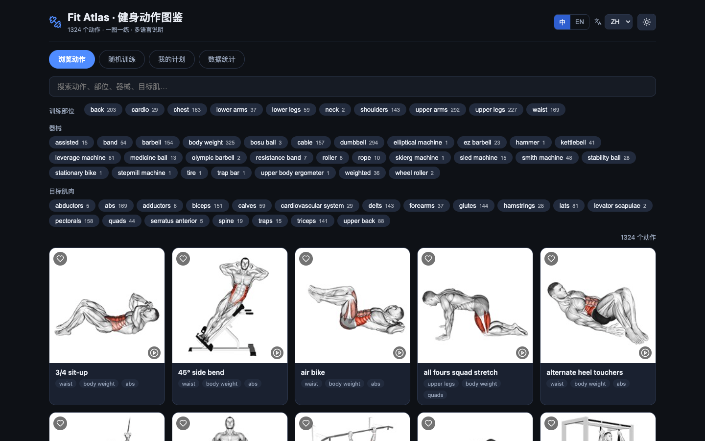

<div align="center">

# 🏋️ Fit Atlas · 健身动作图鉴

**1324 个健身动作 · 一图一练 · 10 种语言说明**

一个更现代、更好用的健身动作查询与训练工具，基于开源数据集 [exercises-dataset](https://github.com/hasaneyldrm/exercises-dataset) 构建。



</div>

## ✨ 主要功能

| 功能 | 说明 |
| --- | --- |
| 🔍 **组合筛选** | 训练部位 × 器械 × 目标肌肉任意组合，每个选项实时显示命中数量 |
| ⌨️ **模糊搜索** | 支持动作名、部位、器械、目标肌、中英文说明全文检索 |
| 🌍 **多语言** | 10 种语言的动作分步说明随时切换（中/英/西/意/土/俄/印地/波/韩/法），界面支持中英文 |
| 🎲 **随机训练** | 从当前筛选结果中随机抽取 N 个动作，一键生成一组训练 |
| 📋 **训练计划** | 收藏动作、新建/删除计划、按目标肌肉一键生成计划、一键复制清单 |
| 📊 **数据统计** | 部位/类别/器械/目标肌分布可视化，数据一目了然 |
| 🌗 **深色/浅色** | 双主题切换，本地保存偏好 |
| 💾 **本地优先** | 无需注册，收藏与计划保存在浏览器本地 |

## 🚀 快速开始

需要 Node.js 20+。

```bash
npm install
npm run dev        # 开发模式 → http://localhost:5173
npm run build      # 构建到 dist/（自动复制数据与媒体）
npm run preview    # 预览构建产物
```

> 直接打开静态文件（`index.html`）无法读取数据，请使用开发服务器或构建后部署。

### GitHub Pages 部署

```bash
npm run build
# 将 dist/ 内容推送到 gh-pages 分支，或使用 GitHub Actions 自动部署
```

## 📦 数据文件

| 文件 | 说明 |
| --- | --- |
| `data/exercises.json` | 完整结构化数据（1324 条 × 10 语言） |
| `data/exercises.csv` | 平铺表格（含英文与中文说明），适合 Excel/数据分析 |
| `data/exercises.sqlite.sql` | SQLite 建表 + 1324 条 INSERT |
| `data/exercises.postgres.sql` | PostgreSQL 建表 + 1324 条 INSERT |
| `data/stats.json` | 数据统计与完整性校验结果 |
| `data/exercises.schema.json` | JSON Schema |
| `images/` | 1324 张动作缩略图（180×180） |
| `videos/` | 1324 个动作演示 GIF |

字段说明见 [docs/dataset.md](docs/dataset.md)，数据质量报告见 [docs/data-report.md](docs/data-report.md)，代码示例见 [docs/api-examples.md](docs/api-examples.md)。

所有增强数据（CSV / SQL / 统计）均由 `scripts/build_data.py` 从 `exercises.json` 自动生成，可复现：

```bash
python3 scripts/build_data.py
```

## 🧠 使用示例

```python
import json
from pathlib import Path

exercises = json.loads(Path("data/exercises.json").read_text(encoding="utf-8"))
chest = [e for e in exercises if e["body_part"] == "chest" and e["equipment"] == "dumbbell"]
print(len(chest), "个哑铃胸部动作")
for e in chest[:3]:
    print(" -", e["name"], "| 目标肌:", e["target"])
```

更多 Python / JavaScript / SQL 示例见 [docs/api-examples.md](docs/api-examples.md)。

## 🧾 数据字段

每条动作记录包含：`id`、`name`（动作名）、`category`（类别）、`body_part`（训练部位）、`equipment`（器械）、`target`（目标肌）、`muscle_group`（主肌群）、`secondary_muscles`（辅助肌群）、`instructions`（10 语言说明）、`instruction_steps`（10 语言分步说明）、`image`（缩略图）、`gif_url`（演示 GIF）、`attribution`（媒体署名）。

## 📌 未编造字段的说明

本项目**不虚构**难度等级、卡路里消耗、组数次数建议等运动科学数据——这类数值需要权威来源支撑，避免误导使用者。如需补充，请参考 ACSM 指南或设备厂商数据并注明来源。

## ⚖️ 许可与署名

| 范围 | 许可 |
| --- | --- |
| 应用代码（本项目） | MIT |
| 动作数据（源自 exercises-dataset） | MIT，Copyright (c) 2026 Hasan Emir Yıldırım，见 [LICENSE](LICENSE) |
| 动作媒体（缩略图与 GIF） | © Gym visual — https://gymvisual.com/ ，使用条款见 [NOTICE.md](NOTICE.md) |

- 数据与媒体来自开源项目 [hasaneyldrm/exercises-dataset](https://github.com/hasaneyldrm/exercises-dataset)。
- 使用媒体时请保留每条记录中的 `attribution` 字段及 NOTICE 说明。
- 应用界面与交互为本项目新增代码，按 MIT 许可发布。

## 📁 项目结构

```
fit-atlas/
├── data/            # 数据集（JSON / CSV / SQL / 统计）
├── images/          # 1324 张动作缩略图
├── videos/          # 1324 个动作演示 GIF
├── src/             # React 应用源码
├── scripts/         # 数据构建与资源复制脚本
├── docs/            # 文档与预览图
├── LICENSE          # MIT（含原作者版权声明）
└── NOTICE.md        # 媒体署名与使用条款
```
